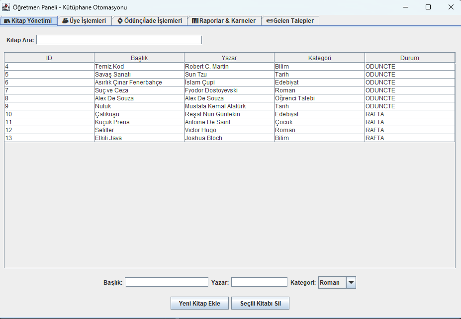
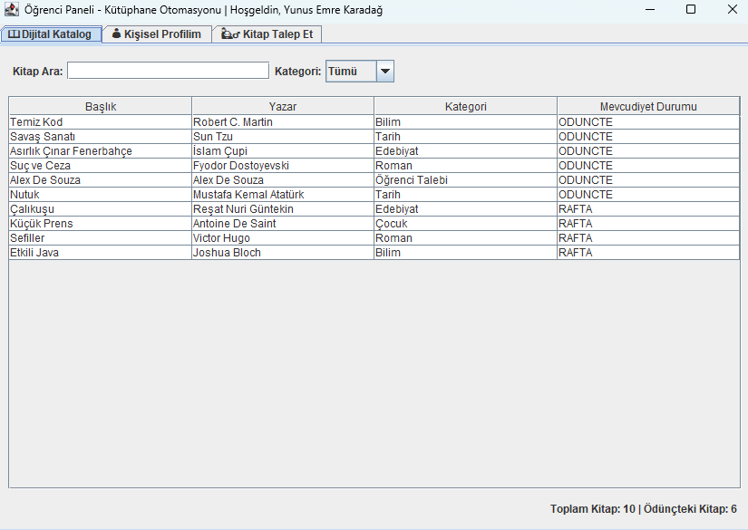

# Köy Okulu Kütüphane Otomasyonu

Bir köy okulunun kütüphanesi için geliştirilmiş, kitap kataloğunu ve ödünç/iade işlemlerini dijital ortamda yöneten bir masaüstü uygulaması. Öğretmen ve öğrenciler için ayrı paneller bulunur.

## Ekran Görüntüleri

**Öğretmen Paneli**



**Öğrenci Paneli**



## Özellikler

### Giriş
- Kullanıcı adı ve şifre ile giriş
- Role göre (öğretmen / öğrenci) ilgili panele yönlendirme

### Öğretmen Paneli
- **Kitap Yönetimi:** Kitap arama, listeleme, yeni kitap ekleme ve silme; kitabın rafta mı ödünçte mi olduğunu görme
- **Üye İşlemleri:** Öğrenci ve kullanıcı kayıtlarının yönetimi
- **Ödünç / İade İşlemleri:** Kitap ödünç verme ve iade alma
- **Raporlar & Karneler:** Kütüphane kullanımına dair raporlar
- **Gelen Talepler:** Öğrencilerin kitap taleplerini görüntüleme

### Öğrenci Paneli
- **Dijital Katalog:** Kitap arama, kategoriye göre filtreleme ve mevcudiyet durumunu görme
- **Kişisel Profilim:** Öğrencinin kendi bilgileri
- **Kitap Talep Et:** Kütüphanede olmayan kitaplar için talep oluşturma

## Kullanılan Teknolojiler

- **Java** (Swing ile masaüstü arayüz)
- **SQLite** (JDBC ile, `sqlite-jdbc` kütüphanesi)

## Veritabanı Yapısı

Uygulama ilk çalıştırıldığında proje klasöründe `kutuphane.db` adlı yerel bir veritabanı oluşturur.

| Tablo | Açıklama |
| --- | --- |
| `Users` | Kullanıcılar ve rolleri (öğretmen / öğrenci), öğrenci numarası |
| `Books` | Kitap kataloğu: ad, yazar, kategori ve durum (rafta / ödünçte) |
| `Transactions` | Ödünç alma ve iade kayıtları; `Books` ve `Users` tablolarına foreign key ile bağlı |

## Proje Yapısı

```
src/
├── Main.java            # Uygulamanın başlangıç noktası
├── DatabaseHelper.java  # Veritabanı bağlantısı ve tablolar
├── LoginUI.java         # Giriş ekranı
├── TeacherUI.java       # Öğretmen paneli
└── StudentUI.java       # Öğrenci paneli
lib/
└── sqlite-jdbc          # SQLite sürücüsü
```

## Çalıştırma

1. Projeyi klonlayın:
   ```bash
   git clone https://github.com/yekaradag/Kutuphane-Otomasyonu.git
   ```
2. Eclipse'te **File → Import → Existing Projects into Workspace** ile projeyi açın (veya VS Code'da klasörü açın).
3. `lib` klasöründeki `sqlite-jdbc` dosyasının classpath'te olduğundan emin olun.
4. `src/Main.java` dosyasını çalıştırın.

## Geliştirici

**Yunus Emre Karadağ** · [GitHub](https://github.com/yekaradag)
